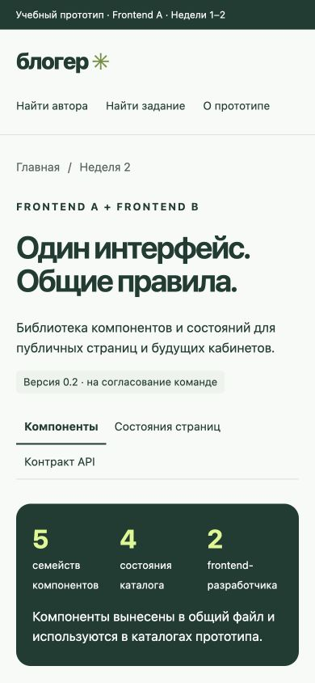

# Блогер — Frontend A

Учебный прототип площадки для небольших авторов и рекламодателей. Работа **Frontend A (разработчик 3) за первые две недели**: публичные страницы, два пути поиска партнёра, общие компоненты и макеты состояний.

Проект работает на HTML, CSS и JavaScript без зависимостей и сборки. Это прототип; окончательный стек платформы ещё не согласован.

## Быстрый запуск

Скачайте репозиторий или клонируйте его, затем откройте **`dist/index.html`** в браузере. Интернет и установка пакетов не нужны.

Для запуска через локальный сервер, если установлен Python:

```bash
python3 -m http.server 4173 --bind 127.0.0.1 --directory dist
```

Откройте [локальный прототип](http://127.0.0.1:4173/). Остановка сервера — `Ctrl+C`.

## Что сделано

| Неделя | Результат |
| --- | --- |
| 1 | Главная, каталог авторов, каталог компаний и заданий, профили авторов, карточки рекламных заданий, демонстрационные формы приглашения и отклика |
| 2 | Общие кнопки, поля, карточки, сообщения, окно подтверждения; состояния загрузки, ошибки и пустой подборки; предложение контракта API и пример ответа |

Каталоги фильтруются по площадке и бюджету. Параметры сохраняются в адресе страницы. Данные карточек, имена, показатели и суммы вымышлены и обозначены как учебные.

## Как проверить сценарии

1. **Рекламодатель:** главная → «Я ищу автора» → цена до 4 000 ₽ → Саша Медведева → «Предложить сотрудничество» → предварительный просмотр предложения на 3 600 ₽.
2. **Автор:** главная → «Я ищу задание» → задание книжного клуба «Страницы» → «Откликнуться» → предварительный просмотр с каналом «Город для своих», идеей и ценой 2 500 ₽.
3. **Компоненты:** ссылка «Компоненты и состояния» внизу страницы → проверка формы → очистка полей через окно подтверждения. Отмена и Escape сохраняют данные.
4. **Состояния:** в библиотеке открыть «Состояния страниц» → выбрать загрузку, пустой результат или ошибку одного из каталогов.

Сценарии первой недели заканчиваются демонстрацией перехода к обсуждению. Ничего не отправляется на сервер, заказы не создаются.

## Основные маршруты

Маршрут добавляется после имени файла или адреса сайта:

| Маршрут | Экран |
| --- | --- |
| `#home` | Главная |
| `#authors` | Каталог авторов |
| `#jobs` | Каталог компаний и заданий |
| `#author/sasha` | Профиль Саши |
| `#job/stranicy` | Задание книжного клуба |
| `#components` | Библиотека компонентов |
| `#components?view=states` | Макеты состояний каталогов |
| `#components?view=api` | Предложение контракта API |
| `#guide` | Сценарии и границы прототипа |

## Структура

```text
dist/
  index.html           Оболочка приложения
  style.css            Общие стили и адаптивная сетка
  app.js               Учебные данные, страницы и маршрутизация
  ui.js                Общие компоненты
  components.js        Демонстрация компонентов и состояний
  api-contract.txt     Предложение API для Backend A
  api-example.json     Учебный пример ответа
check.cjs              Проверки первой недели
check-week2.cjs        Проверки второй недели
evidence/              Снимки проверенных экранов
MASTER-PROMPT.txt       Мастер-промпт роли Frontend A
WEEK1-REVIEW.txt        Результаты и отчёт первой недели
WEEK2-REVIEW.txt        Результаты и отчёт второй недели
WEEK2-COMPONENTS.txt    Инструкция по общим компонентам
START-HERE.txt         Инструкция и шаблон сдачи
validation*.txt        Результаты программных проверок
```

Папка `dist` содержит исходный код сайта, а не результат сборки: её нужно хранить в Git.

## Проверки

Для программных проверок нужен Node.js 18 или новее. Сторонние пакеты не нужны.

```bash
npm run check
npm test
```

Или без npm:

```bash
node check.cjs
node check-week2.cjs
```

Всего 17 программных проверок. Проверки первой недели используют упрощённые DOM-объекты и не заменяют браузерное тестирование. Скрипты обновляют `validation.txt` и `validation-week2.txt`.

В браузере проверялись оба пути поиска партнёра, фильтры, валидация, окно подтверждения, управление фокусом и состояния каталогов. Проведена выборочная проверка мобильной и широкой версии. Полная кроссбраузерная и скринридерная проверка ещё не проведена.

## Материалы для команды

- [Отчёт первой недели](WEEK1-REVIEW.txt)
- [Отчёт второй недели](WEEK2-REVIEW.txt)
- [Общие компоненты для Frontend B](WEEK2-COMPONENTS.txt)
- [Предложение контракта для Backend A](dist/api-contract.txt)
- [Пример JSON](dist/api-example.json)
- [Мастер-промпт Frontend A](MASTER-PROMPT.txt)

Компоненты, навигация и контракт API подготовлены **для согласования**, но согласование с Backend A и Frontend B ещё не проведено. В шаблонах сдачи имя участника и название модели оставлены для заполнения.

## Границы реализации

- Авторизация, база данных, сообщения, платежи и реальные интеграции не подключены.
- Загрузка и ошибка в демонстрационном режиме включаются параметром `demo` в URL и не имитируют реальный серверный ответ.
- Контракт описывает предлагаемые методы и поля, а не существующий API.
- Формы кабинета и работа с заказом относятся к Frontend B.
- Изображения — условные иллюстрации; видео представлены текстами раскадровок.


